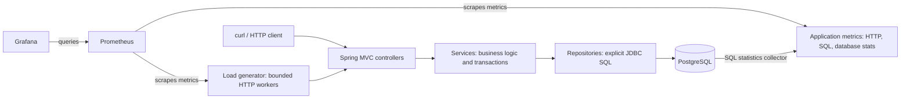
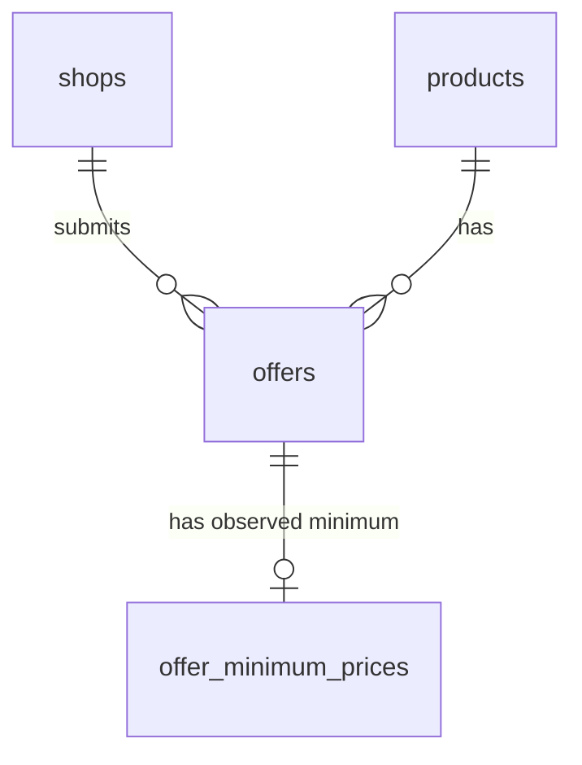

# postgres-playground

**PriceRadar** is a price comparison application. Shops submit product offers, customers retrieve the cheapest available offers for a product, and incoming price observations maintain a separate historical minimum for each offer. Prices are integer EUR cents: `12999` means €129.99.

This local PostgreSQL laboratory provides reproducible experiments for three database behaviors:

- Concurrent INSERTs can deadlock even with `ON CONFLICT DO NOTHING`.
- A plausible composite index may not support the query's filtering and ordering efficiently.
- An UPDATE that leaves a value unchanged can still create row versions and generate WAL.

Each experiment has an explicit problematic mode and an improved alternative. This is a local development environment, not a production deployment.

The stack uses Java 25, Spring Boot 4.1.1 with Spring MVC and Spring JDBC, Flyway, PostgreSQL 18.6, Gradle 9.2.1, Docker Compose, Prometheus, and Grafana. There is no ORM; repositories contain the SQL executed by the application.

## Quick start

Install Docker with Compose v2 and Make. Host `curl` is used for Make's API calls. No host Java or Gradle is required.

```sh
make help
make up
make seed
make demo-deadlock
make demo-deadlock-ordered
```

| Service | Address |
| --- | --- |
| PriceRadar | http://localhost:8080 |
| Actuator metrics | http://localhost:8080/actuator/prometheus |
| Prometheus | http://localhost:9090 |
| Grafana | http://localhost:3000 — admin / priceradar |
| PostgreSQL | localhost:5432 — database/user/password: priceradar |

All published ports bind to localhost. Grafana provisions its Prometheus data source and four dashboards into the PriceRadar folder automatically. Database statistics are collected by a small SQL collector in the app, so a separate PostgreSQL exporter is unnecessary. The CLI load container starts only on demand.

`make down` stops and removes containers **without deleting volume data**. `make reset` **deletes this Compose project's database and monitoring volumes**. `make seed` **replaces all business data** with the fixed demo dataset. Stop loads before any reset or index switch. Do not run multiple scenarios simultaneously during comparisons.

Suggested Docker resources: 4 CPUs, 4 GB RAM, and 5–8 GB free disk including images/build cache. Individual service memory caps total about 3 GB with load. The small dataset has 400 shops × 1,000 products = **400,000 offers**; allow roughly 100–300 MB for database data/indexes and additional WAL/storage headroom. `make seed SIZE=large` creates 1,000 × 3,000 = **3 million offers**; allow 1–2 GB database headroom and 8 GB Docker RAM if increasing service limits for large experiments. Initial image pulls/builds can take several minutes; small seed usually takes seconds to tens of seconds, large seed can take minutes. These are capacity estimates, not benchmark results.

## Structure and choices

The application package is `dev.valart.postgreslab`. The build uses Gradle with Groovy DSL (`build.gradle`, `settings.gradle`) and the complete official Gradle Wrapper. No automated tests are included. Lombok is used only at compile time for constructor injection where no custom initialization is needed.

```text
build.gradle / settings.gradle   Groovy build scripts
gradlew / gradlew.bat / gradle/   Gradle 9.2.1 Wrapper
src/main/java/dev/valart/postgreslab/
  api/          separate shop, product, offer, minimum, observation and lab controllers
  model/        domain packages, one request/response record per file
  service/      business operations, transaction/retry boundaries, lab coordination
  repository/   explicit JDBC SQL
  monitoring/   five-second SQL statistics collection
src/main/resources/db/migration/  Flyway schema
loadgen/        standalone Java HTTP CLI, bounded workers
monitoring/     Prometheus config and provisioned Grafana dashboards
docs/           version sources, verification and experiment walkthrough
api.http        runnable business/lab examples
```

Controllers call services, which call repositories. Ordinary writes use `@Transactional`. Batch operations use a small `TransactionTemplate` boundary so metrics can be recorded **after commit**; imports additionally need an entirely new transaction for every retry. Spring auto-configures MVC, JDBC, Hikari, Flyway, Actuator, and Micrometer. No web frontend or automated tests are included. [Version decisions and official compatibility references](docs/versions.md) explain the pinned stack.

Controllers and services with plain dependency injection use `@RequiredArgsConstructor` and final fields. Services that configure transaction templates or initialize counters keep explicit constructors. Shop and product operations have separate services and SQL repositories, and every DTO—including the lab responses—is a standalone record in its domain package.

### Request and monitoring flow



The application listens on port 8080. The load generator is a separate client process, not another business API: it sends requests to `http://app:8080` inside the Compose network. Its internal port 9091 serves only Prometheus metrics.

### Database relationships



The schema has shops → offers ← products. `offers(shop_id,product_id)` is unique. Offers carry current price, availability, and update timestamp. `offer_minimum_prices` has one row per observed offer, keyed by offer ID. Its price has no observation timestamp, so unchanged observations do not hide a real timestamp mutation. Essential integrity comes from NOT NULL, CHECK, FK, PK, and UNIQUE constraints. EUR is a fixed demo currency rather than a column on every row.

Offer imports and PATCH update the current catalog. Historical minima are driven independently by `/api/price-observations/batch`; an offer without observations has no minimum and the minimum endpoint returns 404. Seed initializes every minimum from its current price as an initial observation. Both observation modes initialize a missing row from the first observed price identically, then process further observations. This keeps minimum-price experiments separate from legitimate current-offer updates.

## Business API

Use [api.http](api.http) in an HTTP client, or on a fresh empty database:

```sh
curl -fsS -X POST localhost:8080/api/shops -H 'Content-Type: application/json' -d '{"name":"Example Shop"}'
curl -fsS -X POST localhost:8080/api/products -H 'Content-Type: application/json' -d '{"name":"Mechanical Keyboard"}'
curl -fsS -X POST localhost:8080/api/offers/batch -H 'Content-Type: application/json' \
  -d '{"offers":[{"shopId":1,"productId":1,"currentPrice":12999,"available":true}]}'
curl -fsS -X PATCH localhost:8080/api/offers/1 -H 'Content-Type: application/json' \
  -d '{"currentPrice":11999,"available":true}'
curl -fsS 'localhost:8080/api/products/1/offers?limit=20'
curl -fsS -X POST localhost:8080/api/price-observations/batch -H 'Content-Type: application/json' \
  -d '{"observations":[{"offerId":1,"observedPrice":11999},{"offerId":1,"observedPrice":13999}]}'
curl -fsS localhost:8080/api/offers/1/minimum
```

Use returned IDs if data already exists. Shops and products also have GET endpoints by ID. PATCH supplies both price and availability. Import defaults to ordered, no retry; observations default to conditional. Each batch contains 1–500 items; read limit is 1–100. Invalid modes/settings return 400. Constraint failures return a readable 400; exhausted deadlocks return 409. No validation framework is introduced.

## Running workloads

`make up` starts the application, PostgreSQL, Prometheus, and Grafana. The optional `load` Compose profile starts only when a load command is requested.

The standalone Java load generator reads its settings, prepares scenario data, starts its metrics endpoint, runs warm-up and measurement phases, prints request counts, and exits after a ten-second final scrape window. Each worker sends synchronous HTTP requests as fast as responses arrive; there is no fixed requests-per-second target.

| Command | Generated workload |
| --- | --- |
| `make load-reads WORKERS=8 DURATION=60` | Repeated cheapest-offer queries for product 777 |
| `make load-deadlock MODE=unordered DURATION=60` | Concurrent overlapping offer imports using fresh product keys each round |
| `make load-updates MODE=conditional DURATION=120` | Price-observation batches, mostly above the stored minimum |
| `make stop-load` | Stops the generator without stopping the application |

Defaults are eight workers, batches of 20 items, and ten seconds of warm-up. `DURATION` specifies the measured phase, not total process runtime; setup, warm-up, in-flight requests, and the final scrape window add time. `ROUNDS` uses a fixed request count instead and skips warm-up. Seed before read or update workloads. Load counters distinguish submitted requests/items, successful completions, and failures; completed items are not necessarily inserted or updated rows.

## INSERT deadlocks

Two imports for the same shop overlap because an import was retried or submitted twice. A unique constraint prevents duplicate committed rows, but a transaction can still wait for another transaction's unique-key decision.

```sql
INSERT INTO offers(shop_id, product_id, current_price, available)
VALUES (?, ?, ?, ?)
ON CONFLICT (shop_id, product_id) DO NOTHING;
```

Each batch is one transaction. `unordered` uses request order; `ordered` sorts by `(shop_id,product_id)` before inserting. **Every participant** must use the same ordering for this prevention to work.

```sh
make demo-deadlock
make demo-deadlock-ordered
make demo-deadlock RETRY=true
```

The unordered demo allocates two initially absent shop/product keys X and Y. Two worker transactions insert X and Y respectively, then signal a latch. The coordinator releases A to attempt Y and checks `pg_stat_activity` until A is actually waiting on a lock. It then releases B to attempt X. PostgreSQL detects the cycle and aborts one transaction with **40P01**. This depends on observed transaction state, not a guessed sleep interval. Polling has a five-second bound; latches and statements have timeouts. The ordered demo uses only a start gate: a barrier after the first insert would be wrong because one worker can already be waiting on that first key.

Retry is optional and bounded to three attempts. The service catches 40P01 **outside** the failed transaction, waits 30 ms then 60 ms between attempts, and retries the **entire batch** in a new transaction. Demo coordination runs on the first attempt only. Never retry a statement inside an aborted transaction.

Under sustained contention, all three attempts can fail and the logical request returns 409. Retry is recovery with a limit, not a guarantee of success or a substitute for consistent ordering.

```sh
make load-deadlock MODE=unordered WORKERS=8 BATCH_SIZE=20 DURATION=60 OVERLAP=0.8 RETRY=false
make load-deadlock MODE=unordered WORKERS=8 BATCH_SIZE=20 DURATION=60 OVERLAP=0.8 RETRY=true
make load-deadlock MODE=ordered WORKERS=8 BATCH_SIZE=20 DURATION=60 OVERLAP=0.8 RETRY=true
make reset-imports
```

The CLI allocates fresh products before every round. A rounded `batch size × overlap` portion is common to every worker; remaining keys are private. Workers shuffle insertion order with fixed per-worker random seeds. The next round starts after all HTTP calls complete, but there is **no artificial coordination inside load transactions**. Product allocation is setup, excluded from client request metrics; it does add database work and gaps between rounds. `OVERLAP=0` means no shared keys, `1` means all shared keys. Defaults are deliberately laptop-friendly. Workers are bounded to 1–16 and duration to 1–1,800 seconds.

Volume alone does not cause this cycle: it needs overlap, concurrent transactions, and inconsistent order. Load deadlocks are probabilistic, while the dedicated demo is coordinated. Ordered insertion prevents this specific cycle, not every deadlock an application might have. Experiments use reserved names `__lab-import-shop` and `__lab-import-product`; do not use those names in ordinary business examples. `reset-imports` removes this reserved lab data only.

The INSERT dashboard separates logical submitted batches, transaction attempts, deadlocks, retries, successful logical batches, and **committed inserted rows**. Conflict-only successful batches may insert zero rows. Rolled-back writes never enter the committed-row counter.

## Composite indexes

Customers ask for the 20 cheapest available offers for one product:

```sql
SELECT id, shop_id, product_id, current_price, available, last_updated_at
FROM offers
WHERE product_id = ? AND available = true
ORDER BY current_price, id
LIMIT 20;
```

The `id` tie-breaker makes ordering deterministic. Compare:

```sql
-- none: only primary-key and unique-constraint indexes
CREATE INDEX offers_poor_idx ON offers(available, current_price, product_id);
CREATE INDEX offers_good_idx ON offers(product_id, available, current_price, id);
```

The fixed seed is 42. Seed prices and availability use deterministic integer formulas rather than database random state. Every shop/product pair occurs once; 90% of offers are available. Product **777** has prices in a higher band than other products. In a poor-index price traversal, the engine may need to traverse a large region containing other products before finding the requested product's cheapest rows. An index condition on a trailing column does not necessarily mean a small part of the index is traversed. The good index puts this product's available offers together in the requested order, including the tie-breaker. The selected plan may use a sort, sequential scan, incremental sort, or PostgreSQL 18 skip-scan behavior: read the actual plan and buffer counts.

```sh
make seed
make index-none
make explain-offers
make load-reads WARMUP=10 DURATION=60
make index-poor
make explain-offers
make load-reads WARMUP=10 DURATION=60
make index-good
make explain-offers
make load-reads WARMUP=10 DURATION=60
```

Each switch drops both experimental indexes before adding the selected one and runs ANALYZE. Constraint indexes remain. No planner settings disable sequential scans. `explain-offers` executes **EXPLAIN (ANALYZE, BUFFERS)**; it is a real query execution. Save plans separately to compare access paths and buffer usage.

The [captured PostgreSQL 18.6 plans](docs/plans/) show a useful nuance: the baseline uses the existing unique shop/product index with repeated index searches and a top-N sort. The poor index uses one price-ordered traversal and incremental sort; even though `product_id` appears in its Index Cond and only 21 rows reach the parent node, it touches 1,798 buffers. The good index returns 20 rows with 23 buffers and no sort. That broad poor-index traversal is inferred from its ordering, data distribution, index searches and buffers; EXPLAIN does not report a count of all rejected index entries. These initial executions include different cache states, so their execution times are not a comparable benchmark.

```sh
mkdir -p artifacts
make explain-offers > artifacts/current-plan.txt
```

Use identical product, worker count, warm-up and duration; run one workload at a time. Warm-up preloads caches but does not clear OS/shared-buffer caches, so these are warm-cache comparisons. The CLI is closed-loop: faster queries produce more requests in the same interval. Compare server SQL latency and measured client throughput in Grafana. Try a normal-priced product as a contrasting workload using `PRODUCT_ID=1`. No exact speedup is promised. Low-cardinality columns are not universally bad index candidates, and swapping two equality-filtered leading columns alone need not make a large difference.

## Unnecessary minimum-price UPDATEs

Naive mode runs an UPDATE for every observation on an existing minimum:

```sql
UPDATE offer_minimum_prices SET min_price = LEAST(min_price, ?)
WHERE offer_id = ?;
```

Conditional mode only updates when a new minimum is established:

```sql
UPDATE offer_minimum_prices SET min_price = ?
WHERE offer_id = ? AND ? < min_price;
```

Both initialize a missing row with `INSERT ... ON CONFLICT DO NOTHING`; a newly initialized row needs no additional UPDATE in either mode. They produce the same business result for the same successful observation stream. No timestamp changes on observations.

```sh
make reset-minima
make load-updates MODE=naive DURATION=120 NEW_MINIMUM_RATE=0.01
make reset-minima
make load-updates MODE=conditional DURATION=120 NEW_MINIMUM_RATE=0.01
make vacuum
```

The CLI selects up to 1,000 existing minima per worker and partitions them so workers own disjoint offers. Each worker uses `Random(42 + worker)` and selects an offer uniformly. With probability `NEW_MINIMUM_RATE`, it lowers that offer's locally tracked minimum by one cent; otherwise the observation is 100–10,099 cents above that minimum. Prices stop decreasing at zero. The default produces roughly 1% new minima; it is a probabilistic proportion, not an exact quota. Duplicate observations of one offer within a batch preserve their request order. Batches sort by offer ID to avoid distracting lock-order cycles.

Reset minima before each comparison and leave current offers unchanged. Duration-based comparisons have different numbers of observations when throughput differs. For identical business-result checks use `ROUNDS=100` (per worker), identical settings, and no failed requests. ROUNDS automatically skips warm-up. [Manual verification](docs/manual-verification.md) includes full-table checksums. The reset truncates and rebuilds the minimum table to give equivalent row/physical starting data, but database-wide cumulative stats and monitoring counters are not reset. Cache/checkpoint state can still differ; use warm-up and repeat comparisons if making performance claims.

PostgreSQL MVCC keeps row versions so readers see a consistent snapshot. Updating a row normally creates a new row version even when `LEAST` returns the same price. Old versions can become obsolete. WAL records recovery information for changes. Eligible **HOT** updates can avoid new index entries when indexed values are unchanged and there is room on the same heap page; they still create versions and consume work/WAL. The minimum table uses fillfactor 80 to leave some page room, and only its unchanged offer ID is indexed.

Autovacuum stays enabled. Vacuum removes reclaimable obsolete versions and enables space reuse. Ordinary VACUUM generally does **not** return relation space to the operating system (it can sometimes truncate empty tail pages). Reuse and pruning can keep file size stable even while unnecessary updates consume CPU, locks, and WAL. Dead tuple estimates and relation sizes are not precise measurements of bloat.

If ordinary local load does not show sustained dead-row accumulation, use the optional controlled experiment:

```sh
# terminal A: bounded old REPEATABLE READ snapshot
make hold-snapshot SECONDS=120
# terminal B, while A is holding the snapshot
make load-updates MODE=naive DURATION=90 WARMUP=0
# after A completes
make vacuum
```

This introduces an **additional cause**: an old snapshot prevents vacuum from reclaiming versions needed by that reader. The synchronous endpoint holds one read-only transaction, bounded to 180 seconds, and releases its connection/transaction on completion or error. A disconnected curl alone need not cancel the SQL: the database query still completes within its bound. Don't reset minima or seed while holding the snapshot, because TRUNCATE needs an incompatible lock. Use it only to explain cleanup limits, not as the default UPDATE workload.

## Observability caveats

Four dashboards cover application/workload, INSERT deadlocks, composite indexes, and minimum updates. Panels have descriptions and correct seconds/bytes/operations units. HTTP and SQL latency histograms provide approximate percentiles. Rates and increases are applied to cumulative counters; gauges show instantaneous sizes, row estimates, active workers, and lock waiters. Labels are limited to fixed modes, outcomes, phases, scenario names and HTTP route templates.

SQL collection uses `pg_stat_wal`, `pg_stat_database`, `pg_stat_user_tables`, `pg_stat_activity`, `pg_table_size`, and `pg_indexes_size` every five seconds. [PostgreSQL statistics documentation](https://www.postgresql.org/docs/18/monitoring-stats.html) describes their scope and delays. WAL bytes are **cluster-wide generated bytes**, not WAL retained on disk. Database reads/hits and deadlocks cover this database, not a single query. Table counters can include physical work from aborted transactions; application counters report committed work. PostgreSQL stats are delayed and reset on some resets/restarts. Short lock waits can disappear between samples. Compare one isolated workload at a time and use actual query plans for per-query buffer attribution.

For exact WAL interval boundaries, record the before and after SQL values and subtract:

```sh
docker compose exec -T postgres psql -U priceradar -d priceradar -Atc 'SELECT wal_bytes FROM pg_stat_wal'
```

Grafana's `increase(...[$__range])` is a scrape-based estimate. Include the measurement period only, excluding seed/reset/warm-up. Prometheus scrapes the CLI's named Compose service; the load target is normally down when no load runs. CLI counters remain available for ten seconds after completion so a final scrape can occur. Each load starts a new process and resets its counters; application counters persist until app restart. The collector-up gauge reveals failures rather than pretending stale samples are current.

## Troubleshooting

If ports are occupied, stop conflicting services or edit the localhost mappings (and Make's `API` if changing app port). Docker must have enough memory/disk and network access to image registries, Gradle distributions, the Gradle Plugin Portal and the dependency repository. `docker compose logs app postgres` shows migrations and database errors. `make up` waits for health checks; failed app builds/health checks should be diagnosed before issuing loads. Check `docker compose ps` and `/actuator/health`. Seed before reads/updates; deterministic deadlocks work on an empty database. Missing Grafana data can mean no requests yet, a stopped load container, an insufficient rate window, or collector failure; use Prometheus's Targets page and `priceradar_db_collector_up`.

The Dockerfiles use BuildKit cache mounts. Docker Desktop includes Buildx; a CLI-only Docker installation may need the [official Buildx plugin](https://github.com/docker/buildx#installing). A `docker-buildx: no such file or directory` error is a host plugin issue rather than an application failure.

The default credentials and unrestricted lab endpoints are intentional for a localhost lab. Dataset/index/reset commands are blocking; stop loads first. PostgreSQL deadlock timeout is shortened to 200 ms to keep the local experiments responsive; this is not a production tuning recommendation. Reading minima after catalog PATCH does not imply that PATCH submitted a historical observation.

[Manual verification](docs/manual-verification.md) provides reproducible functional checks. [Actual verification results](docs/verification-results.md) records what was checked and its limits. The [experiment walkthrough](docs/experiments.md) connects the implementation, commands, plans, and dashboard panels. Re-run comparisons in your own environment: hardware, cache state, PostgreSQL version, and data distribution affect outcomes.
